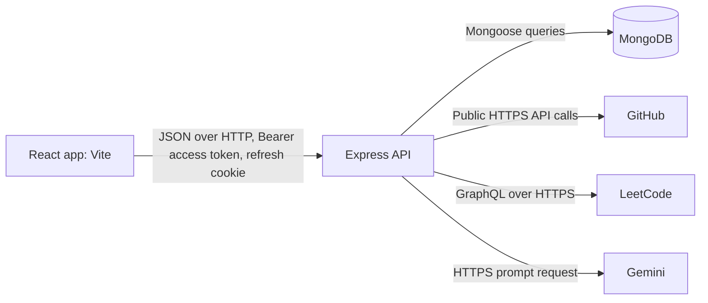

# TrackPort Engineering Log and Learning Guide

**Updated:** 25 November 2026  
**Purpose:** A map of the real application, the reasons behind its workflows, and a reading plan for learning from the code. This document describes the active implementation in the repository; it is not a list of aspirational features.

---

## 1. Project at a glance

TrackPort is a single-page student developer workspace. A signed-in student can manage projects, project and personal tasks, log solved DSA problems, review progress summaries, connect public repository URLs, and ask an AI study coach for suggestions.

The application has two processes and one database:



The frontend code that currently runs starts at `frontend/index.html`, which loads `frontend/src/main.jsx`. The active screens are mostly `.jsx`. The repository also has a parallel `.tsx` starter UI; `main.tsx` and `App.tsx` are not loaded by `index.html`. Avoid assuming that two files with the same screen name are equivalent.

The backend starts at `backend/server.js`. It connects to MongoDB before opening its HTTP port. `backend/src/app.js` configures middleware and mounts the feature routers.

## 2. Run and configure locally

### Requirements

- Node.js 20 or newer.
- MongoDB running locally or a MongoDB URI you can access.
- Optional: Gemini, Google OAuth, and GitHub OAuth credentials for those integrations.

### Setup

1. Copy `backend/.env.example` to `backend/.env` and set `DB_URI` and a private, random `JWT_SECRET` with at least 32 characters.
2. Run `npm run dev:backend` from the repository root.
3. In a second terminal run `npm run dev:frontend`.
4. Open the Vite URL, normally `http://localhost:5173`, and register an account.

The frontend defaults to `http://localhost:5000/api`. Set `VITE_API_URL` in `frontend/.env` to change it. Do not commit `.env` files. The root `.gitignore` now ignores local environment files, dependency trees, and generated frontend output.

For production, set `CLIENT_URL` to the exact browser origin and `API_URL` to the externally reachable API origin. The OAuth callback URLs registered with Google and GitHub are:

- `${API_URL}/api/auth/google/callback`
- `${API_URL}/api/auth/github/callback`

The refresh cookie defaults to `SameSite=Lax`, which suits local development and same-site deployments. A genuinely cross-site frontend/API deployment needs HTTPS and `COOKIE_SAME_SITE=none`. The API CORS allowlist must also contain the exact frontend origin.

## 3. Repository map

### Frontend

| Path | Responsibility |
|---|---|
| `frontend/src/main.jsx` | Creates the React root, route tree, and `AuthProvider`. |
| `frontend/src/context/AuthContext.jsx` | Owns the signed-in user, startup session check, login, registration, logout, and profile update state. |
| `frontend/src/services/api.js` | Shared Axios client, in-memory access token, cookies, and one-time refresh-and-retry behavior. |
| `frontend/src/services/*.service.js` | Small feature-specific API wrappers. They keep URL and HTTP details out of screen components. |
| `frontend/src/layouts/AppLayout.jsx` | Protected application frame with navigation, theme controls, and nested page outlet. |
| `frontend/src/components/Sidebar.jsx` and `components/layout/Navbar.jsx` | Active navigation and global header. |
| `frontend/src/pages/*.jsx` | Active route screens: dashboard, projects, project detail, tasks, DSA, analytics, settings, and authentication. |
| `frontend/src/components/ui/*.tsx` | Reusable Radix-based primitives styled with Tailwind. Active JSX screens import some of these TypeScript components. |
| `frontend/src/hooks/useTheme.js` | Shared theme state for all components, persisted in `localStorage`. |
| `frontend/src/index.css` and `frontend/tailwind.config.js` | CSS variables, theme colors, typography, glass helpers, and Tailwind configuration. |

`frontend/src/main.tsx`, `App.tsx`, duplicate page `.tsx` files, and several older component/data files are not part of the active router. They remain useful as reference material, but do not silently edit one expecting the active route to change.

### Backend

| Path | Responsibility |
|---|---|
| `backend/server.js` | Startup checks, database connection, and `app.listen`. |
| `backend/src/app.js` | CORS, JSON parsing, Passport initialization, mounted routes, 404 handling, and centralized error formatting. |
| `backend/routes/*.routes.js` | Maps HTTP method/path pairs to authentication middleware and handlers. |
| `backend/controllers/*.controller.js` | Validates request input, applies ownership rules, calls models/services, and returns JSON. |
| `backend/models/*.model.js` | Mongoose schemas, validation, timestamps, references, and indexes. |
| `backend/middlewares/auth.middleware.js` | Verifies access JWTs and loads the associated user. |
| `backend/utils/auth-session.js` | Access-token signing and hashed, rotating refresh-cookie sessions. |
| `backend/utils/sanitize-user.js` | Defines the safe public user shape; password hashes are never part of that shape. |
| `backend/services/*.service.js` | Outbound GitHub, LeetCode, and Gemini HTTPS requests. |
| `backend/db/db.js` | Reads the backend environment file and opens the Mongoose connection. |
| `backend/passport.js` | Optional Google and GitHub OAuth strategies and provider-account lookup. |

## 4. Libraries and why they are here

| Library | Used for | What to learn from it |
|---|---|---|
| React 18 | Component rendering and local UI state. | A screen renders from state; event handlers request changes to that state. |
| React Router | Nested routes, URL parameters, navigation, and route guards. | The route tree in `main.jsx` mirrors the app shell and access boundaries. |
| Vite | Local development server and production bundling. | It follows the HTML module entry and resolves the `@` alias from Vite config. |
| Axios | JSON requests, request/response interceptors, and cookie credentials. | `api.js` is the boundary between React features and HTTP. |
| Tailwind CSS | Utility classes and responsive styling. | Layout and spacing are mostly composed in JSX; CSS variables define theme colors. |
| Radix UI | Accessible interaction primitives such as dialogs, selects, and dropdowns. | The `components/ui` files wrap behavior; feature pages provide the content. |
| Lucide React | Consistent SVG icons. | Icons are imported as React components and styled with the same utility classes. |
| Express 5 | HTTP routing and middleware pipeline. | Requests pass through CORS/JSON/auth/router/error middleware in `app.js`. |
| Mongoose | MongoDB models, validation, queries, indexes, and population. | Schemas describe stored data; controllers decide which query is safe for the current user. |
| bcryptjs | One-way password hashing and comparison. | A password is never stored or recovered; login compares a candidate with its hash. |
| jsonwebtoken | Short-lived signed access tokens. | A JWT carries a user identifier and expiry; the server verifies its signature on protected requests. |
| Passport OAuth strategies | Google/GitHub authorization-code sign-in. | Passport handles provider redirects and profile retrieval; TrackPort still creates its own session. |
| Node `https` and `crypto` | Outbound provider calls, secure random refresh values, and hashing refresh values before storage. | These services avoid adding a second HTTP client to the backend. |

The frontend package also contains UI-kit and TypeScript starter dependencies that are not used by every active screen. Check imports before removing a dependency. A library being present in `package.json` does not mean the active app uses it.

## 5. How the request workflow works

### A normal protected API request

1. A page calls a feature service, for example `getProjects()` in `frontend/src/services/project.service.js`.
2. The service calls the shared Axios client in `frontend/src/services/api.js`.
3. The request interceptor adds `Authorization: Bearer <access token>` from in-memory state.
4. Express matches the route in `backend/src/app.js`, then the feature router.
5. `authUser` verifies the access token, fetches the user, and puts that user on `req.user`.
6. The controller scopes database reads and writes to `req.user._id`, then returns a JSON envelope such as `{ success: true, data: ... }`.
7. The page updates React state from the response and renders the result.

The route/controller/model split gives each file one job: routing declares the API surface; middleware applies cross-cutting checks; controllers coordinate a use case; models enforce stored-data rules; services isolate external APIs.

### Access JWT and refresh-token lifecycle

The access token lasts **15 minutes**. The refresh session lasts **7 days**. They have different jobs: the access token is sent to protected API routes, while the refresh value is only sent as an HttpOnly cookie to the authentication endpoints.

1. On local login or registration, `auth.controller.js` checks credentials or creates the account. Passwords are hashed with bcryptjs.
2. `auth-session.js` signs an access JWT with the user ID, `type: access`, issuer, and audience. The API returns it in JSON.
3. The server generates a cryptographically random refresh value. MongoDB stores only its SHA-256 hash in `RefreshSession`, with an expiry. The raw value is set in the `trackport_refresh` HttpOnly cookie.
4. `AuthContext` keeps the access token in React state and `api.js` memory. It is not intentionally persisted in `localStorage`. The refresh cookie cannot be read by page JavaScript.
5. If a request returns 401, the Axios response interceptor makes one shared `POST /api/auth/refresh` call. The browser sends the cookie because the Axios client uses `withCredentials`.
6. The server finds and deletes the old, unexpired token hash, issues a new refresh cookie, and returns a fresh access JWT. The interceptor retries the original API request once with the new token.
7. If refresh fails, the in-memory token is cleared and the user is sent to sign-in. If a page reloads, `AuthContext` asks for `/auth/me`; the same interceptor can refresh from the cookie before retrying `/auth/me`.
8. Logout calls `POST /api/auth/logout`, deletes the current refresh-session hash, clears the cookie, and clears React memory.

The refresh token is **rotated** so each successful refresh invalidates the previous value. Refresh sessions are per login/device. The MongoDB TTL index cleans up expired records eventually; the refresh query also checks `expiresAt`, so expiration does not depend on the background cleanup schedule. Existing installations that only have the old `localStorage` JWT and no refresh cookie may need to sign in again after this change.

### OAuth sign-in

Google and GitHub routes exist but require provider credentials. The server creates a short-lived random `state`, stores it in an HttpOnly cookie, sends it through the provider redirect, and compares the returned state at the callback. Passport fetches the profile. A provider identity is matched to its existing account; a verified matching email can link the provider; otherwise a new account is created with a generated username. TrackPort then issues its own access and refresh credentials. The access token is temporarily returned in the URL fragment, which the `/auth/callback` page immediately removes from browser history before calling `/auth/me`.

If OAuth credentials are absent, the sign-in screen shows a clear message and email/password login remains available. Never put provider secrets in frontend environment variables.

## 6. Data model and feature flows

### User

`backend/models/user.model.js` stores the account identity, password hash, education fields, provider usernames/IDs, and `dailyGoal`. `select: false` keeps the password out of ordinary queries. `sanitize-user.js` is the response allowlist. `PUT /api/users/me` only updates an explicit set of profile fields; the email is intentionally read-only in the UI.

### Project

`Project` belongs to a `userId` and stores title, description, status, repository/live URLs, and technologies. `project.controller.js` owns CRUD and checks that the signed-in user owns a project before reading or changing its detail. List results include task counts from an aggregation. Search treats user input as literal text instead of executing it as a regular expression.

### Task

`Task` belongs to a user and can optionally reference a project. `projectId` is optional in both the model and API. A project task is checked against project ownership before creation. The project page sorts its tasks by `order`; the global task view groups by project and disables cross-project reordering because order is meaningful within one project. Project deletion removes associated tasks in the controller.

### DSA practice

`DsaProblem` stores a user-owned problem title, platform, difficulty, topic, optional URL, and solved date. `GET /api/dsa` derives total, today, rolling seven-day, current-month, daily-goal, and current-streak values from those saved records. Dates are grouped by UTC day so the streak calculation has one consistent calendar rule. Logging and deleting a problem updates the persisted history; the DSA screen no longer ships example streaks or example solved problems.

The platform username fields are saved in Settings and the DSA page links to the corresponding public profiles. LeetCode data is also fetched by the AI coach when a username is present. TrackPort does not currently import Codeforces submissions or automatically merge external platform submissions into the local DSA history.

### Dashboard and analytics

`dashboard.controller.js` aggregates project counts, task counts/completion, recent projects, and upcoming task deadlines. `dash.routes.js` is mounted at `/api/dashboard`. The dashboard also reads DSA progress and, for up to three projects with public GitHub repository URLs, reads current repository metadata. GitHub figures shown are repository count, stars, forks, language, and open issues; they are not commit or contribution history.

The Analytics page computes project status distribution, task completion, and technology frequency from the authenticated project/task APIs. “Projects Tracked” is a count, not a time-based velocity calculation. The AI study coach posts a prompt to `/api/analytics/chat`. The server may attach public GitHub profile summary and LeetCode public statistics before calling Gemini. The API key stays on the backend.

## 7. API map

Every feature router is mounted from `backend/src/app.js`.

| Prefix | Method and path | Auth | Purpose |
|---|---|---:|---|
| `/api` | `GET /health` | No | Health response. |
| `/api/auth` | `POST /register`, `POST /login` | No | Create account or start a local session. |
| `/api/auth` | `GET /me` | Access JWT | Return sanitized signed-in user. |
| `/api/auth` | `POST /refresh`, `POST /logout` | Refresh cookie | Rotate or revoke the refresh session. |
| `/api/auth` | `GET /google`, `/google/callback`, `/github`, `/github/callback` | Provider config | Optional OAuth flow. |
| `/api/projects` | `GET/POST /`, `GET/PUT/DELETE /:id` | Access JWT | Project CRUD, list filtering, project detail, and deletion. |
| `/api/tasks` | `GET/POST /`, `GET/PUT/DELETE /:id`, `PUT /reorder` | Access JWT | Task CRUD, optional project filter, and ordered updates. |
| `/api/users` | `PUT /me`, `PUT /me/goal` | Access JWT | Update allowed profile fields and daily goal. |
| `/api/dashboard` | `GET /` | Access JWT | Dashboard aggregate. |
| `/api/dsa` | `GET /`, `POST /problems`, `DELETE /problems/:id` | Access JWT | Practice history and derived progress. |
| `/api/analytics` | `POST /chat` | Access JWT | Gemini study-coach response with public account context. |
| `/api/integrations` | `GET /github?url=...` | Access JWT | Public GitHub repository summary. |

Controllers return consistent `success` and `data` fields. The final Express error middleware maps common Mongoose validation/cast and duplicate-key errors to client status codes and hides stack traces outside development.

## 8. Design system and frontend workflow

The active shell uses a scenic background with a translucent glass panel, a left navigation rail, a global header, and scrollable route content. Tailwind utilities define most layout details. CSS variables in `index.css` define semantic colors for light and dark themes. Radix components provide keyboard and focus behavior for dialogs, dropdowns, and selects; TrackPort applies its own visual classes around those primitives.

`useTheme.js` uses `useSyncExternalStore` around one module-level value. That makes the navbar and Settings screen observe the same theme state. It writes the preference to `localStorage` because theme is a non-sensitive display preference, and toggles the `dark` class on the document root.

The active route tree is:

```text
AuthProvider
└── ProtectedRoute
    └── AppLayout
        ├── /dashboard
        ├── /projects
        ├── /projects/:id
        ├── /tasks
        ├── /dsa
        ├── /analytics
        └── /settings
Public routes: /auth/login, /auth/register, /auth/callback
```

The global search input is synchronized with the `search` query parameter on `/projects`; the project list debounces changes before requesting the API. The menu shortcut focuses it on desktop and navigates to Projects on small screens.

## 9. Concepts to connect to code

- **REST routes:** Start in `backend/routes`. A route is the public method/path contract, not the business logic.
- **Middleware:** `authUser` runs before protected controllers. It makes identity available as `req.user`; controllers still need to include that identity in their database filters.
- **Ownership and authorization:** Authentication answers “who is calling?” Ownership checks answer “may this user access this record?” Follow both checks in project/task controllers.
- **Mongoose schema vs controller validation:** Schemas protect stored data regardless of caller. Controllers can return clearer errors and check relationships before a write.
- **Indexes:** The user/status, user/deadline, and project/order indexes support common query shapes. An index speeds matching and sorting by storing an additional data structure; extra indexes cost storage and write time.
- **Populate vs aggregation:** `populate` replaces a stored reference with selected related fields. Aggregation groups records inside MongoDB, such as task counts per project. Read the projection carefully so APIs do not accidentally return whole related documents.
- **React state and effects:** `useState` holds the current screen view. `useEffect` loads records when a screen mounts or its filters change. The server remains the durable source of truth; state is the current rendered snapshot.
- **React Context:** `AuthContext` shares account/session state across deeply nested screens without passing props through every layout component.
- **Axios interceptors:** Request interceptors attach shared headers; response interceptors centralize refresh behavior so every feature service does not implement token renewal separately.
- **JWT:** A signed token proves the API issued a claim and that it has not expired. A JWT is not encrypted; do not put secrets in its payload. TrackPort's JWT contains identity and token metadata.
- **Refresh vs access token:** A refresh credential should live longer and be harder for page scripts to read. TrackPort stores only its hash in MongoDB and sends the raw value in an HttpOnly cookie. The access JWT remains short-lived and in memory.
- **Cookie and CORS:** A credentialed browser request needs the frontend's exact origin allowed by CORS and `withCredentials` enabled. `SameSite` and HTTPS settings affect whether the browser sends the refresh cookie.
- **OAuth:** OAuth signs the user in with a provider, but the app still needs its own local account/session. OAuth `state` binds the callback to a sign-in started in the same browser.
- **External API adapter:** GitHub, LeetCode, and Gemini request code lives in backend services. This keeps provider-specific HTTP details, timeouts, and response parsing out of React components.
- **LLM context:** The AI coach receives the user's prompt plus public account summaries. It is not a source of truth and may produce incorrect advice; API errors should be shown as errors, not fabricated analytics.

## 10. A guided reading plan

Read one complete request from the button to MongoDB and back. This is more useful than reading every file in alphabetical order.

### Pass A: Follow a project request

1. `frontend/src/pages/Projects.jsx`: find `fetchProjects`, the filter state, and create/edit/delete handlers.
2. `frontend/src/services/project.service.js`: see how UI actions become HTTP calls.
3. `frontend/src/services/api.js`: follow token attachment and common error behavior.
4. `backend/src/app.js` and `backend/routes/project.routes.js`: locate the route and `authUser` middleware.
5. `backend/middlewares/auth.middleware.js`: see how the token becomes `req.user`.
6. `backend/controllers/project.controller.js`: trace validation, user ownership, and queries.
7. `backend/models/project.model.js`: compare persisted fields and schema validation.
8. Return to the page and follow response data into React state and rendered project cards.

### Pass B: Understand sessions

Read `frontend/src/context/AuthContext.jsx`, `frontend/src/services/auth.service.js`, `frontend/src/services/api.js`, `backend/routes/auth.routes.js`, `backend/controllers/auth.controller.js`, `backend/utils/auth-session.js`, `backend/models/refresh-session.model.js`, and `backend/middlewares/auth.middleware.js` in that order. Draw the cookie and access-token paths separately. Then explain to yourself what happens when `/auth/me` receives an expired token, when the refresh cookie is expired, and when logout is called.

### Pass C: Understand tasks and DSA

- Tasks: `frontend/src/pages/Tasks.jsx` → task service → task routes/controller → `tasks.model.js`. Pay attention to `projectId` being optional and `order` being per project.
- DSA: `frontend/src/pages/DSATracker.jsx` → DSA service → DSA routes/controller → `dsa-problem.model.js`. Work through the UTC day grouping and streak loop with a few example dates.

### Pass D: Understand integrations and app composition

- Startup: `backend/server.js` → `db/db.js` → `src/app.js`.
- Nested route composition: `frontend/src/main.jsx` → `ProtectedRoute.jsx` → `AppLayout.jsx` → an individual page.
- GitHub: project form URL → dashboard `getGitHubStats` call → integration route → `github.service.js`.
- AI: Analytics prompt form → `/analytics/chat` → route context gathering → `gemini.service.js`.

## 11. Practical engineering workflow for future changes

Use this sequence before and during a feature so the log remains useful and you understand the result:

1. **State the user outcome.** Write one concrete sentence about what changes for a student.
2. **Trace the existing path.** Identify the page, service, API route, controller, model, and any external service involved. Search references before creating a parallel file.
3. **Write the contract.** Decide the request fields, response shape, ownership rule, and validation errors before editing both sides.
4. **Change one layer at a time.** Implement model constraints, controller behavior, route wiring, frontend service, then screen state. Keep each layer's responsibility clear.
5. **Follow the data.** Check empty/loading/error/success states, a reload, and a second user's ownership boundary. A screen that only updates local React state is not persisted.
6. **Run the relevant quality gates.** Use frontend build, lint, and typecheck; use backend syntax checks and, when a test database is available, API/database tests.
7. **Update this log.** Record the date, changed files, behavior before/after, design reason, concepts to review, commands run, results, and unresolved limits.
8. **Review the diff.** Check that no environment file, dependency tree, generated output, or unrelated alternate implementation entered the change.

For learning, after each feature, try to explain: “Which layer owns this decision? What data crosses this boundary? What can fail? Where is that failure translated into a user-visible result?” If the answer is unclear, improve the code or its notes before moving on.

## 12. Changes completed in this pass

### Backend wiring and data correctness

- Mounted dashboard, user, analytics, and DSA routers. Initialized Passport and added bounded JSON parsing, a frontend-origin CORS allowlist, and common validation/duplicate-key status mapping.
- Added a persistent `DsaProblem` model and authenticated read/create/delete routes. Dashboard and DSA screens now derive logged totals, current streak, today’s goal, and week/month counts from saved records.
- Added authenticated profile updates for education details, platform usernames, and daily goal. Settings now reports actual save success/failure.
- Aligned standalone-task support across model, API, and UI. Task ordering validates IDs/orders; the global all-project view does not offer ambiguous cross-project reorder controls.
- Escaped project search text and added input checks for profile/task/project operations.

### Authentication and integration workflow

- Replaced the long-lived browser-persisted access JWT with 15-minute access JWTs held in memory and seven-day rotating refresh sessions stored as hashes in MongoDB and sent with HttpOnly cookies.
- Added a shared Axios refresh request, retry-once logic, logout revocation, and startup validation for the signing secret.
- Repaired OAuth’s ESM token signing and callback flow, added state-cookie validation, provider-user creation/linking, and a frontend callback route. OAuth still requires external credentials.
- Protected GitHub repository lookup, added URL validation and request timeouts, and show actual public repository metadata on the dashboard.
- Mounted the AI analytics route, fixed GitHub profile context lookup, added timeouts, and connected the Analytics coach form to Gemini.

### Frontend and repository quality

- Made theme state shared between the shell and Settings, synchronized global project search with the URL, removed fake DSA/GitHub/profile success data, and corrected the favicon reference.
- Cleaned TypeScript lint/type errors in shared UI and inactive starter files without routing the application through the duplicate TypeScript app.
- Added root ignore rules and placeholder `.env.example` files; added a setup README.

## 13. Verification and remaining boundaries

### Environment configuration follow-up — 2026-11-25

The local environment files now contain the configuration keys this implementation expects. I checked key names and whether values are present without printing or recording any secret values:

- Backend `.env`: `DB_URI` (MongoDB connection), `JWT_SECRET` (access and refresh-token signing; at least 32 characters), `PORT` (Express listener), `CLIENT_URL` (frontend origin for CORS and OAuth redirects), `API_URL` (backend base URL used to build provider callback URLs), `GEMINI_API_KEY` (AI coach), and Google/GitHub client ID and secret pairs (OAuth strategies).
- Frontend `.env`: `VITE_API_URL` (browser API base URL). It is configured to match `API_URL` with `/api` appended. Vite only exposes variables prefixed with `VITE_` to browser code; backend secrets belong only in the backend environment file.
- Runtime configuration check: both OAuth strategies registered, Gemini configured, JWT secret passed the minimum-length check, and API/client URLs were present. No provider sign-in or Gemini request was made, so credentials were not validated against the external services.
- Updated the backend `dev` script to watch `.env` as well as `server.js`; restart an already-running backend once after changing config. Production `start` remains `node server.js` and reads environment at process startup.

Learning path for this configuration: read `backend/server.js` and `backend/passport.js` (process startup and strategy registration), `backend/db/db.js` (database connection), `backend/middlewares/auth.middleware.js` (JWT verification), `backend/services/gemini.service.js` (AI key use), then `frontend/src/services/api.js` (browser API base URL and refresh behavior). Trace each setting from environment loading to the point of use. `.env` files contain machine-specific secrets and must stay ignored; `.env.example` files document names and safe placeholders only.

Commands run for this pass:

- Inspected environment variable names and presence using a value-redacting check: **passed**.
- Imported Passport and checked strategy/configuration status without exposing values: **passed**.
- Compared frontend `VITE_API_URL` to `API_URL` + `/api`: **matched**.
- The updated nodemon command is configured to restart on `.env` changes; it was not left running as part of verification.

Commands run for this pass:

- `npm run build` in `frontend`: **passed**. Vite reports a 568 kB minified JavaScript chunk, above its 500 kB advisory threshold, and the local Browserslist data is old. Neither warning prevents the build.
- `npm run lint` in `frontend`: **passed with six Fast Refresh warnings** from shared component files that export both components and helpers.
- `npm run typecheck` in `frontend`: **passed**.
- `node --check` over backend JavaScript source files: **passed**.

There is no configured automated backend test suite in the package scripts. I did not run a MongoDB-backed integration flow, provider sign-in, external API call, or live Gemini request. Those require a reachable database and/or real credentials/network access.

Current service boundaries to remember:

- Google/GitHub OAuth requires provider credentials and correct callback URLs. Email/password auth does not.
- The AI coach requires `GEMINI_API_KEY`. It sends prompts and public platform summary data to Gemini.
- GitHub data is public repository metadata, limited to up to three linked project repositories on the dashboard. It is not contribution history; GitHub's unauthenticated API rate limit applies.
- AI analytics conditionally reads compact project and locally saved LeetCode summaries from MongoDB based on the prompt. It no longer calls LeetCode or GitHub for every AI question. Codeforces is linked as a profile but is not synchronized into TrackPort's local history.
- Password-reset emails, a notification service, and automatic external DSA submission ingestion are not implemented.
- The app's production bundle is functional but would benefit from route-level code splitting when the feature set grows.

---

## Change entry template

### 2026-11-25 — OAuth options on registration

User outcome: A new student can start account creation with Google or GitHub from the signup page as well as the login page.

Files changed: `frontend/src/pages/Register.jsx`, `engineering_logs.md`.

Request/data flow: Provider buttons navigate the browser to the same backend endpoints used by login (`/api/auth/google` and `/api/auth/github`). Passport performs OAuth and the backend callback creates or finds the user, then the frontend OAuth callback loads the account and completes the session. The provider flow itself is shared; only its entry points are offered on both screens.

Why this design/workflow: OAuth already handles both new and returning provider users, so the signup screen can reuse that established flow rather than create a separate registration implementation. The email form remains available under a clear divider.

Libraries or concepts to understand: React event handlers, `window.location.assign` for a full-page OAuth redirect, Express OAuth routes, Passport strategies, OAuth callback, and the frontend callback route.

How I checked it: Inspected the login provider URLs and backend OAuth route wiring, then added matching provider links to registration. No build or external OAuth sign-in was run for this small UI change.

Known limits or next learning step: Provider setup still depends on server credentials and correctly configured callback URLs. OAuth failures continue to return to the login screen, including failures started from signup.

### 2026-11-25 — Preserve signup intent through OAuth

User outcome: Starting Google or GitHub OAuth from signup returns provider/configuration failures to signup and shows a signup-specific message. Successful OAuth continues to establish the session and open the dashboard.

Files changed: `backend/routes/auth.routes.js`, `frontend/src/pages/Register.jsx`, `frontend/src/pages/OAuthCallback.jsx`, `engineering_logs.md`.

Request/data flow: Signup appends `mode=signup` when opening the backend OAuth start route. The backend restricts the value to `register` or `login` and stores it in a short-lived HttpOnly cookie alongside the random OAuth state cookie. On callback it validates the OAuth state, reads the intent, clears both cookies, and routes errors to the originating auth page. On success, it carries the intent to the frontend callback in a query parameter; if loading the new session fails, the callback returns the user to the matching auth page. The token stays in the URL fragment, which is not sent in the HTTP request to the server.

Why this design/workflow: OAuth is a full-page redirect away from the React app, so local React state cannot reliably remember which page started it. A short-lived HttpOnly cookie survives that round trip without trusting a redirect URL supplied by the browser. The mode is allowlisted to two fixed internal pages; it cannot be used as an open redirect.

Libraries or concepts to understand: OAuth state and CSRF protection, HttpOnly/SameSite cookies, Express redirects, URL query parameters versus fragments, and frontend route error states.

How I checked it: Traced existing OAuth start, state validation, Passport callback, and frontend callback paths; updated each failure exit to preserve the signup/login destination. No automated checks or live provider flow were run.

Known limits or next learning step: The error message still groups provider-side account/email failures together. If signup continues to fail, check the backend runtime error logs to identify the actual Passport/provider or database cause.

### 2026-11-25 — Use verified GitHub email metadata

The reported `[oauth:github] callback failed MongoServerError 11000` pointed to a duplicate unique value during account creation/linking. Inspection of the installed `passport-github2` implementation showed its default mode returns only the primary email value and drops metadata such as `verified`. TrackPort consequently treated the GitHub address as unverified, skipped matching an existing email account, and attempted to create a duplicate email record.

The GitHub strategy now enables `allRawEmails`, which retains GitHub's `primary` and `verified` fields. The account flow now requires a verified GitHub email and uses it to find/link an existing email account before creating a new one. The limited OAuth failure log now also prints MongoDB's `keyPattern` (field names only), which identifies a unique index without exposing the duplicate value or profile data.

Learning path: inspect the `allRawEmails` mapping in `backend/node_modules/passport-github2/lib/strategy.js`, then follow `profile.emails` through `backend/passport.js` into the unique `email` field in `backend/models/user.model.js`. This is an example of verifying library behavior in the installed source before coding against assumed profile data.

How I checked it: Reviewed the installed strategy source and traced the duplicate email path. No database-backed callback test or live GitHub OAuth was run. Restart the backend to reload `passport.js`; if a duplicate error persists, the new key-pattern log will show whether it is `email`, `userName`, or another unique index.

### 2026-11-25 — Ensure OAuth route edits reload in development

The backend Nodemon script previously watched only `server.js` and `.env`. Editing `routes/auth.routes.js` could therefore leave the old OAuth behavior running, which explains why the signup redirect fix might not appear until a manual restart. The development script now watches the backend tree for `.js`, `.json`, and `.env` changes. OAuth callback failures also log only the provider, error class, and database/error code when present; they never log tokens or OAuth profile contents. `node --check backend/routes/auth.routes.js` and package script parsing passed. No backend was listening on localhost in this workspace, so live behavior could not be confirmed here. Restart an already-running backend once so it picks up the broader watch list.

### 2026-11-25 — GitHub repository import and LeetCode question bank

User outcome: Students can turn their public GitHub repositories into TrackPort project records and browse LeetCode problems with their difficulty and topic information before logging a solved problem.

GitHub request/data flow: The Projects page calls `GET /api/integrations/github/repos`. The authenticated route uses the GitHub username saved on the profile and `github.service.js` calls the public `GET /users/{username}/repos` endpoint, requesting up to 100 repositories sorted by recent updates. The modal shows descriptions, language, stars, fork status, and links. Selection is sent to `POST /api/projects/import/github`; the backend refetches the user's repository list (so imported metadata comes from GitHub, not browser-supplied descriptions), skips unavailable or already represented URL/title entries, and stores projects using the existing Project model. Imported projects start as `In Progress`; repository language is the initial tech-stack value.

LeetCode request/data flow: The DSA page calls `GET /api/dsa/leetcode/questions?search=...&skip=...`. The authenticated DSA route calls `getLeetCodeQuestions` in `leetcode.service.js`, which queries LeetCode's GraphQL problem list for title, ID, slug, difficulty, premium status, acceptance rate, status, and topic tags. The UI filters the fetched page by difficulty and topic. “Log solved” sends the selected question through the existing `POST /api/dsa/problems` path with LeetCode URL and topic tags; the DSA history, streak, and goal counters then update from the existing database-backed progress endpoint. Re-logging a problem with the same user and URL returns the existing record.

Why this design/workflow: The project import deliberately reuses the existing Project collection and project/task UI rather than creating a parallel GitHub project store. The import API asks the server to resolve selected repository names against GitHub again, keeping the external data mapping on the backend. The LeetCode question bank remains a catalog; it does not silently claim every question was solved. A student explicitly records a solved question using the existing DSA history flow.

Libraries and concepts to understand: Node `https` requests and response mapping in the GitHub and LeetCode services; Express authentication and route boundaries; GitHub pagination and unauthenticated public access; GraphQL query/variables and LeetCode's undocumented public schema; React effect cleanup/debounce for remote search; and reuse/idempotency in Mongo-backed writes.

How I checked it: `npm run build` in `frontend` passed (Vite still reports the known outdated Browserslist data and >500 kB bundle advisory). `node --check` passed for all changed backend JavaScript modules. No live GitHub request, LeetCode GraphQL request, MongoDB import, or browser flow was run.

Known limits or next learning step: Repository import lists up to 100 public repositories for the profile username; it does not import private repositories or organization repositories. Private repository access would require adding a secure GitHub token flow and storing/using its credentials safely; the current OAuth implementation discards provider tokens. The unauthenticated GitHub REST API is rate-limited. LeetCode's GraphQL endpoint/schema is not a documented stable API, so it may change or block server-side requests; error states are shown in the tracker. Question filters operate on the currently fetched 30-question page, while search and pagination query LeetCode. Existing LeetCode profile statistics remain separate from the saved TrackPort practice history.

### 2026-11-25 — Sync recent accepted LeetCode solves

User outcome: A student can import recent accepted submissions from the LeetCode username stored on their TrackPort profile, with problem difficulty and topic tags added to the DSA history.

Request/data flow: The DSA page calls `POST /api/dsa/leetcode/sync`. The authenticated backend reads `req.user.leetcodeUsername`, calls the public `recentAcSubmissionList` query for up to 20 recent accepted submissions, then fetches metadata for the unique problem slugs using one aliased GraphQL query. It bulk-upserts the results into `DsaProblem`, matching existing rows by LeetCode slug or problem URL, so repeated syncs update the existing row instead of counting it again. A compound partial unique index on `{ userId, leetcodeSlug }` protects imported entries. After the sync, the page reloads the existing progress endpoint so totals and streaks reflect imported history.

Why this workflow: TrackPort currently stores a username, not a LeetCode session cookie. The username-only public query exposes recent accepted submissions but not the complete historical solved-question list. Syncing this bounded public set avoids asking the student to hand over a session secret. The sync is explicit, and only accepted submissions are imported.

Libraries and concepts to understand: LeetCode public GraphQL queries and alias fields; deduplicating external IDs; Mongoose compound partial indexes; MongoDB `bulkWrite` with `updateOne`/`upsert`; mapping timestamps from Unix seconds; and idempotent sync operations.

Known limits: This imports up to 20 recent accepted submissions, not every problem ever solved. Full historical solved-list access requires LeetCode-authenticated progress data; the current app does not collect or store a LeetCode session cookie. The question catalog remains usable for searching older problems, which can be logged manually. No live LeetCode profile query or database-backed sync was run.

### 2026-11-25 — Replace the question bank with full solved-history sync

User outcome: The DSA page is focused on the user's own solved history. It syncs all solved LeetCode questions, sorts them by last accepted solve, loads 15 at a time with “See more,” and derives the activity calendar and streak from those actual solve dates.

Why session credentials are per account: A server-wide LeetCode session would make every TrackPort account read one person's LeetCode data. Instead, each user enters their own `LEETCODE_SESSION` and `csrftoken` through Settings. `backend/utils/leetcode-vault.js` encrypts them with AES-256-GCM using a dedicated server key (`LEETCODE_CREDENTIALS_ENCRYPTION_KEY`) and the user's database ID as authenticated additional data. Mongo selects the encrypted field out by default. Credentials are decrypted only in the sync controller, sent directly to LeetCode, and are never passed to the AI context.

Request/data flow: On DSA page entry, the client reads the user's sync-configured status. If configured, it asks the backend to sync unless a successful sync happened in the last five minutes; the manual Sync button forces a refresh. `leetcode.service.js` verifies that the saved session belongs to the saved LeetCode username, fetches all `SOLVED` rows from LeetCode's authenticated progress query in 1,000-row pages, and maps `lastSubmittedAt`, difficulty, topic tags, title, and slug. The DSA controller bulk-upserts by `(userId, leetcodeSlug)`. `GET /api/dsa?skip=...&timezone=...` returns 15 database rows, aggregate counts, a 365-day date histogram, weekly counts, and a streak calculated in the browser's timezone. “See more” requests the next page. The old public question catalog and 20-recent-submission sync were removed.

Gemini data selection: `backend/routes/analytics.routes.js` classifies prompts for project/DSA intent. Relevant prompts receive bounded Mongo summaries (up to 8 projects or 15 solved questions, with aggregate counts); generic prompts receive no attached dataset, while planning prompts receive a smaller snapshot. External profile calls are made only for explicit GitHub prompts. `gemini.service.js` serializes compact JSON only when context exists. Session cookies never enter AI context.

Configuration required before session save: Add a generated 32-byte base64 key as `LEETCODE_CREDENTIALS_ENCRYPTION_KEY` in `backend/.env`; the example file contains a dummy placeholder and the README has the generation command. Then enter the user's own LeetCode cookie values in Settings. They must never be pasted into chat or committed.

How I checked it: `npm run build` passed. `node --check` passed for the changed backend modules. A targeted ESLint invocation reported the active `.jsx` pages ignored because the repository ESLint config has no matching JSX configuration; it reported no errors in the service files. No session credential, LeetCode live query, MongoDB sync, or Gemini request was available in this workspace.

Known boundaries: LeetCode does not provide a documented stable public API; this full-history endpoint is an authenticated GraphQL query and may change. LeetCode cookies expire and must be refreshed. The app asks LeetCode for pages of 1,000 and caps one sync at 100 pages. The calendar counts unique solved questions by the last accepted timestamp per question, not every accepted submission attempt.

### 2026-11-25 — Use Alfa for recent LeetCode data (current implementation)

This section supersedes the two preceding LeetCode-sync entries: the cookie-encrypted full-history design was removed, and the earlier direct LeetCode GraphQL 20-item sync was replaced. They remain above as historical context for how the requirements changed; do not follow their credential setup instructions.

User outcome: A student enters only their LeetCode username in Settings. TrackPort fetches public solved totals, an activity calendar, and up to 100 accepted submissions from Alfa; it deduplicates the bounded submission window by problem slug and shows the profile summary on the dashboard. The DSA page keeps its 15-row pagination and can import the cached recent set. No LeetCode password, browser cookie, encryption key, or Alfa API key is needed.

Request/data flow: `GET /api/dashboard` checks the user's cached snapshot and, when older than one hour, fetches Alfa's `/:username/profile` and `/:username/acSubmission?limit=100` endpoints in parallel. Alfa's profile response includes solved stats and the activity calendar, so those no longer need separate requests. It caches the normalized result on the User document, then returns summary stats and five recent accepted questions for the dashboard. `POST /api/dsa/leetcode/sync` reads the same cached snapshot or refreshes it, then `bulkWrite`s unique problem slugs into `DsaProblem`; the existing unique partial index makes repeated imports safe. Concurrent backend requests for the same username share one in-flight refresh. `GET /api/dsa` uses the cached Alfa submission calendar for activity and streak, falling back to locally recorded dates if there is no external calendar. The analytics route attaches Alfa totals/calendar and recent accepted problem names only for DSA or planning prompts; it refreshes Alfa at most once per one-hour cache window, so generic prompts do not call Alfa. On HTTP 429, the service honors `Retry-After`/rate-limit reset headers or applies a one-hour cooldown, and DSA sync keeps importing the last saved snapshot when available. `backend/db/db.js` unsets obsolete encrypted-cookie fields from existing User documents after MongoDB connects.

Why this workflow: Alfa documents a global per-IP limit of 120 requests per hour. Two endpoints per refresh, a one-hour per-user cache, a same-process single-flight request, and a shared 429 cooldown reduce requests and prevent dashboard/DSA/AI calls from duplicating work. Keeping Alfa in a backend service isolates URL construction, timeouts, response normalization, validation, and provider errors from React. The snapshot cache preserves the last successful dashboard result during a provider outage. `bulkWrite` upserts make sync idempotent, while the existing database remains the paginated UI source. Activity calendar counts represent LeetCode submissions; they can include multiple attempts in one day and are not the count of distinct newly solved questions.

Libraries and concepts to read: Node's built-in `fetch` and `AbortSignal.timeout` in `backend/services/leetcode.service.js`; Express route → controller → service flow; Mongoose `Mixed` snapshot and `bulkWrite` upserts; cache freshness timestamps; normalize external JSON defensively; unique indexes and idempotency; timezone/date bucketing in `dsa.controller.js`; and relevance-based prompt context in `analytics.routes.js` followed by compact serialization in `gemini.service.js`.

Configuration and data limits: Only the student's public LeetCode username is required. TrackPort requests at most 100 accepted submissions because Alfa documents a configurable `limit` but does not document a provider maximum; repeated accepted submissions may mean fewer than 100 unique problems after deduplication. Alfa does not expose all historical solved question records through this endpoint, so this is a recent window rather than a lifetime list. The endpoint is community-maintained, rate-limited, and can be unavailable or change format. Its accepted-submission response does not reliably include problem difficulty/topic metadata, so those imported rows use `Unknown` rather than inventing values. The activity calendar uses Alfa's reported submission counts; they can include multiple attempts in one day, while the daily solved-problem goal uses locally recorded unique problems. The calendar falls back to locally recorded dates when Alfa data is unavailable.

How I checked it: Alfa's current `app.ts` source documents its 120 requests/hour IP limit and installs that limiter globally. Its user profile GraphQL query contains both accepted-count statistics and `submissionCalendar`. Source inspection confirms TrackPort now requests that profile plus accepted submissions, shares concurrent refreshes, and reuses stale snapshots after 429. No live Alfa request, MongoDB sync, or Gemini request has been made from this workspace.

### 2026-11-25 — Add editable DSA goal and daily completion

User outcome: From DSA Tracker, a student can raise or lower their daily target and use plus/minus buttons to record how many problems they completed today, including LeetCode work outside Alfa's recent submission window.

Request/data flow: Goal buttons call `PUT /api/users/me/goal`, reusing the existing authenticated update route and `User.dailyGoal`. Completion plus/minus buttons call `PUT /api/dsa/daily-progress` with the updated integer count and browser timezone; each tap saves immediately. The backend computes the current date in that timezone and upserts `{userId, date, completedCount}` into `DsaDailyProgress`, protected by a compound unique index. `GET /api/dsa` reads these day records, and the UI displays the greater of the manually reported count and uniquely tracked problems solved today. Calendar activity for a date uses the maximum of LeetCode submission count, locally recorded unique problems, and manually reported completion; using max avoids double-counting the same practice in multiple sources. Old daily entries remain available to the 365-day calendar, while the buttons only edit today's record.

Why this workflow: Daily goal target and completed count are different kinds of data. The target is a long-lived user preference; completion changes each day, so it belongs in a separate per-day collection instead of a single mutable User field. The date is computed server-side from a validated timezone, preventing clients from modifying another day's record. The unique index plus upsert gives one editable daily value per user/date rather than an append-only stream of slider changes.

Libraries and concepts to read: Express protected route and controller validation; `Intl.DateTimeFormat` timezone conversion; Mongoose schema validation and compound unique indexes; `findOneAndUpdate` with `upsert`; React event handlers and async state updates; and aggregation of external, logged, and manually reported counts without summing duplicate sources.

How I checked it: Source inspection only. No build, API request, or MongoDB write was run.

Known boundary: The buttons record a daily total from 0 through 100. Logged problem entries count automatically, and the displayed count will not go below that tracked count. Alfa's contribution calendar still reports submission activity; the manual daily value supplements the calendar but does not create individual problem titles or difficulty metadata.

### 2026-11-25 — Prepare React Router fallback for Netlify

User outcome: Netlify serves the React app for direct visits and browser refreshes on client-side routes such as `/dsa`.

Implementation: Added `frontend/public/_redirects` with `/* /index.html 200`. Vite copies files from `public` into the build output, so Netlify receives its SPA rewrite rule with the generated frontend. Netlify applies the rewrite only after checking for a real static file, then serves `index.html` for app routes so React Router can render the requested view.

How I checked it: Read the Netlify SPA redirect documentation and confirmed the Vite `public` directory exists. No build or live deploy was run.

Netlify deploy troubleshooting: The site returned `main.jsx` as `application/octet-stream`, which means Netlify was serving the unbuilt source HTML instead of Vite's generated asset references. Added a root `netlify.toml` declaring `frontend` as the build base, `npm run build` as the command, and `dist` as the publish directory. This repository configuration takes precedence over conflicting UI settings. The ad-related Permissions-Policy console warnings are browser warnings and are unrelated to the module MIME failure. After pushing this file, trigger a fresh Netlify deploy (clear cache if needed) and verify the deployed HTML references `/assets/*.js` rather than `/src/main.jsx`.

Copy this section for each future piece of work:

```text
### YYYY-MM-DD — Short feature or fix name

User outcome:
Files changed:
Request/data flow:
Why this design/workflow:
Libraries or concepts to understand:
How I checked it:
Known limits or next learning step:
```
